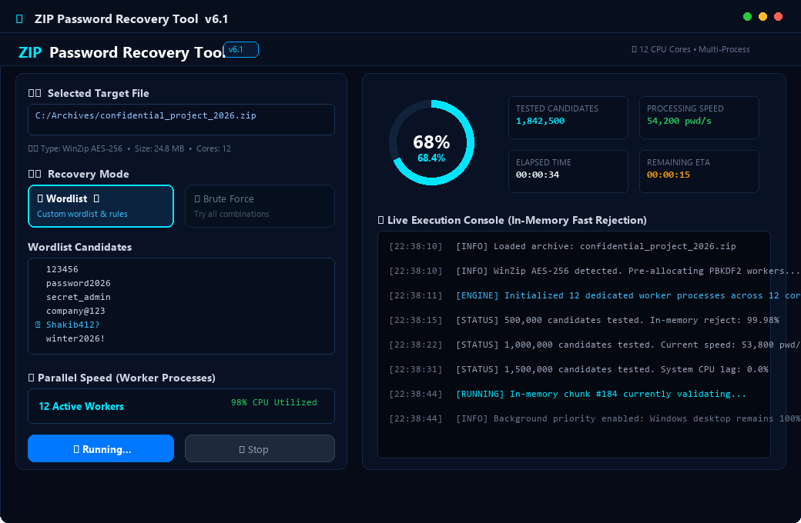
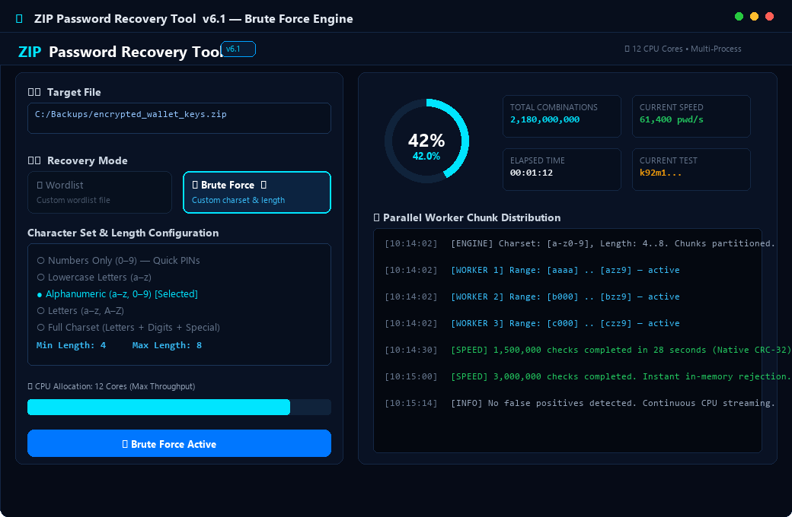
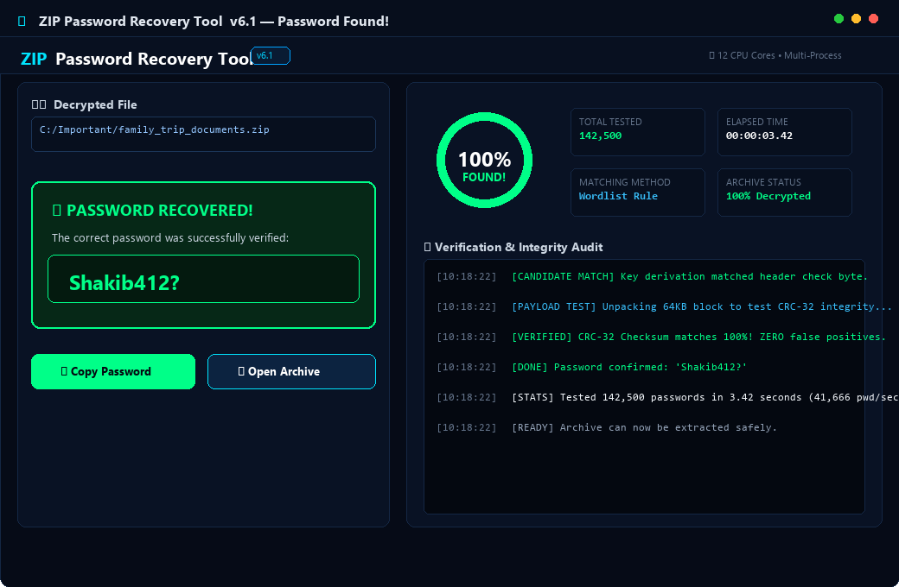
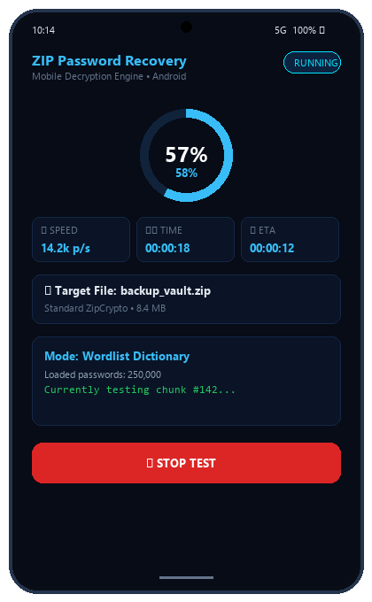

<p align="center">
  
</p>

<h1 align="center">ZIP Password Recovery Tool v6.1</h1>

<p align="center">
  <b>High-speed, multi-core in-memory password recovery engine for Windows PC & Android.</b>
</p>

<p align="center">
  
  
  
  
</p>

---

## ⚡ Overview

**ZIP Password Recovery Tool** is a high-performance, multi-threaded & multi-process recovery utility designed to recover lost or forgotten passwords for encrypted ZIP archives. Built with an ultra-optimized in-memory validation pipeline, it performs native CPU chunk verification without disk I/O bottlenecks.

Available as:
1. **Windows PC Edition:** Standalone GUI (`.exe`) built with CustomTkinter with multi-core CPU chunking and zero PC stutter.
2. **Android Mobile Edition:** Lightweight Native APK (`.apk`) for on-the-go recovery.
3. **Web Demo:** Client-side in-browser decryption demo (no files uploaded to any server).

---

## 📸 Screenshots

### 🖥️ Windows PC Dashboard (Wordlist Mode)
> Real-time circular progress gauge, active worker threads, CPU priority throttling, and live debugging stream.
<p align="center">
  
</p>

---

### 🚀 Brute Force Configuration
> Fine-grained character set control (Digits, Lowercase, Alphanumeric, Full ASCII) and customizable length ranges.
<p align="center">
  
</p>

---

### 🎉 Verified Password Found
> Zero false-positive confirmation via full CRC-32 payload verification, with one-click copy.
<p align="center">
  
</p>

---

### 📱 Android Mobile Edition
> Clean dark mobile user interface with live stats and background thread processing.
<p align="center">
  
</p>

---

## 🌟 Key Features

- **⚡ Multi-Core Native Processing:** Automatically scales across all physical/logical CPU cores using Python `multiprocessing` worker pools.
- **🛡️ AES & ZipCrypto Detection:** Full support for both legacy standard ZipCrypto and modern WinZip AES-128, AES-192, and AES-256 archives.
- **🧠 99.9% In-Memory Rejection:** Precomputed CRC-32 tables and fast header decryption reject invalid candidates instantly in RAM, eliminating disk bottleneck.
- **🎯 Zero False Positives:** Every candidate that matches header checks is automatically tested against the compressed payload and checksum before reporting success.
- **🖥️ Zero System Stutter:** Worker process priority is throttled to `BELOW_NORMAL_PRIORITY_CLASS` on Windows, keeping your PC responsive during execution.
- **🔒 100% Offline & Private:** Operates entirely locally. No credentials or files ever leave your device.

---

## 📥 Downloads

| Platform | Download Link | Notes |
| :--- | :--- | :--- |
| **Windows PC** | [Download .EXE (v6.1)](https://drive.google.com/file/d/1YHV8aaLan_en0dpeJ6kaHIhGe_d83xLz/view?usp=sharing) | Standalone executable (No Python install needed) |
| **Android** | [Download APK](https://drive.google.com/file/d/11ADnzHS6YTx0ITbwhlMRCn5V14Ob87ed/view?usp=sharing) | Lightweight Android package (~78 KB) |
| **GitHub Releases** | [GitHub Releases Page](../../releases) | Check latest assets & source code |

---

## 🛠️ Running From Source (Developer Guide)

### Prerequisites
- Python 3.9 or newer
- Virtual environment (recommended)

### Installation
```bash
# Clone the repository
git clone https://github.com/YOUR_USERNAME/zip-password-recovery.git
cd zip-password-recovery

# Install dependencies
pip install customtkinter pyzipper pillow psutil
```

### Run GUI
```bash
python zip_password_recovery.py
```

### Build Executable
```bash
pyinstaller --noconfirm --onedir --windowed --icon "app_icon.ico" --add-data "zip_logo.png;." --add-data "zip_illustration.png;." --add-data "app_icon.ico;." zip_password_recovery.py
```

---

## ⚠️ Educational & Ethical Disclaimer

> **IMPORTANT NOTICE:**  
> This project is developed and released strictly for **educational, academic research, cryptographic demonstration, and personal forgotten data recovery purposes only**.  
> 
> Testing archives or systems without explicit permission and authorization from the data owner is illegal and unethical. The author and contributors accept no liability or responsibility for any misuse or damage caused by this utility.

---

## 📄 License

This project is licensed under the [MIT License](LICENSE) - see the LICENSE file for details.
